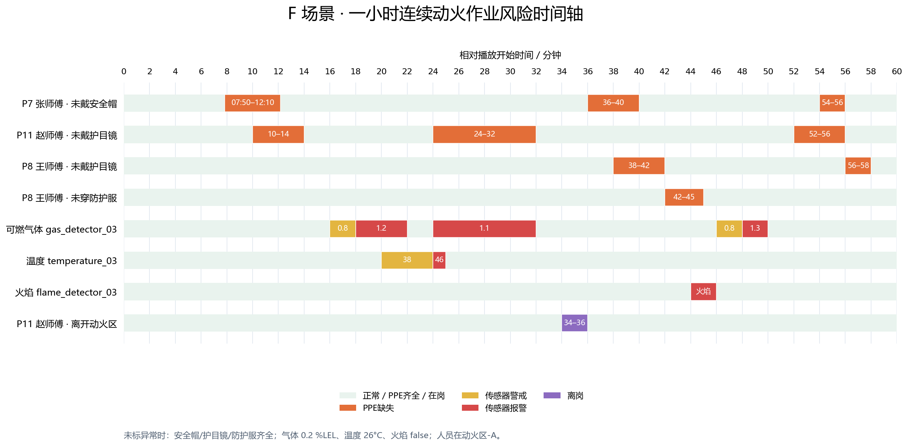

# F 场景：一小时连续动火作业

时长 3600 秒，真实时间 1×播放；未来样本不提前入库。所有时间相对播放开始，区间左闭右开。

人员：P7 张师傅（焊工）、P8 王师傅（焊工）、P11 赵师傅（监护人）。

未列异常时：三人 PPE 齐全且在动火区-A，气体 0.2 %LEL、温度 26°C、火焰 false。

| 对象 | 时间 | 数据设置 |
|---|---|---|
| P7 张师傅 · 未戴安全帽 | 07:50–12:10 | 缺失；abnormal |
| P7 张师傅 · 未戴安全帽 | 36:00–40:00 | 缺失；abnormal |
| P7 张师傅 · 未戴安全帽 | 54:00–56:00 | 缺失；abnormal |
| P11 赵师傅 · 未戴护目镜 | 10:00–14:00 | 缺失；abnormal |
| P11 赵师傅 · 未戴护目镜 | 24:00–32:00 | 缺失；abnormal |
| P11 赵师傅 · 未戴护目镜 | 52:00–56:00 | 缺失；abnormal |
| P8 王师傅 · 未戴护目镜 | 38:00–42:00 | 缺失；abnormal |
| P8 王师傅 · 未戴护目镜 | 56:00–58:00 | 缺失；abnormal |
| P8 王师傅 · 未穿防护服 | 42:00–45:00 | 缺失；abnormal |
| 可燃气体 gas_detector_03 | 16:00–18:00 | 0.8；warning |
| 可燃气体 gas_detector_03 | 18:00–22:00 | 1.2；alarm |
| 可燃气体 gas_detector_03 | 24:00–32:00 | 1.1；alarm |
| 可燃气体 gas_detector_03 | 46:00–48:00 | 0.8；warning |
| 可燃气体 gas_detector_03 | 48:00–50:00 | 1.3；alarm |
| 温度 temperature_03 | 20:00–24:00 | 38.0；warning |
| 温度 temperature_03 | 24:00–25:00 | 46.0；alarm |
| 火焰 flame_detector_03 | 44:00–46:00 | True；alarm |
| P11 赵师傅 · 离开动火区 | 34:00–36:00 | 休息室；absent |

所有来源全程正常采样，无缺测。赵师傅最后一次护目镜异常为52:00–56:00，56:00恢复；58:00–60:00所有人员与传感器均正常，不保留到结束仍持续的异常。

预设状态不是 Agent 研判答案。是否产生事件及何时确认恢复，由实际作业范围、已配置规则和真实采集证据决定。场景加载不会自动修改作业票/规则、启动播放、调用 Agent 或发卡。

一小时预计写入：采集秒 3600、CV 270000、PPE 10800、传感器 10800、定位 10800。A–E 仍为 30 秒。

