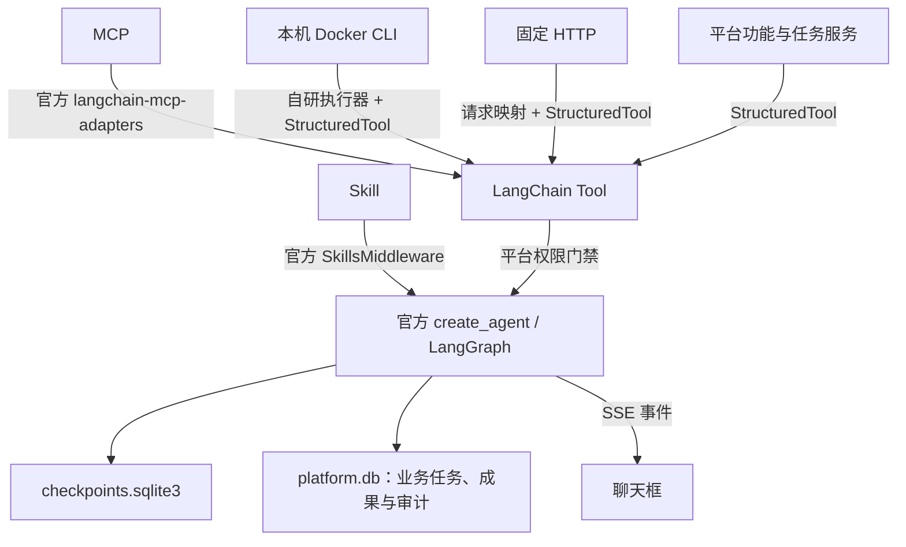

# Skill 与多智能体协作平台

运行时已迁移为 LangChain 1.4.4 / LangGraph 1.2.14。Python 3.12，本机管理页面；固定 Agent 由管理员定义。Skill 使用 Deep Agents SkillsMiddleware，MCP 使用官方 langchain-mcp-adapters 0.3.2，HTTP 与平台功能适配为 LangChain Tool。

## 启动

```powershell
python -m venv .venv
.\.venv\Scripts\python.exe -m pip install -r requirements.lock.txt
.\start-local.ps1
```

打开 http://127.0.0.1:8770/。也可用 `.venv\Scripts\python.exe app.py --port 8770`。使用项目解释器，系统 Python 未安装依赖时不能启动。

会话页支持 Markdown 表格、列表、标题和代码块，隐藏历史及流式回复中的think文本。可新建、命名、删除对话；删除会永久移除对话及消息，无回收站，保留任务和成果。运行中的对话暂不能删除。Ctrl/⌘+Enter发送，Enter换行。更新代码后重启平台并强制刷新浏览器，加载新增的前端资源与会话接口。

## 接入与授权

- **Skill**：导入标准 ZIP，绑定到 Agent；官方中间件只加载授权 Skill 摘要，按需通过只读 `read_file` 读取正文/资源。平台继续校验导入、路径、停用和解绑。
  Skill可选携带`tools.json`和显式Python入口，经管理员配置Docker运行与共享存储、单独授权后进入现有LangChain工具目录。导入不执行代码，模型不自行执行源码。参见[Skill配套工具接入教程](md/Skill配套工具接入教程.md)。
- **MCP**：登记已运行 HTTP/HTTPS 服务；“发现/查看目录”拉取候选工具，确认目录后绑定。当前锁定官方独立适配包；不使用 Beta `langchain.mcp`，也不支持旧自研 2026 无会话协议。
- **CLI**：只登记本机 Docker 容器。一个 `execute` Tool；模型输入为 `{command,input}`。管理员固定容器、容器内程序、工作目录及子命令 argv。禁止宿主机业务 CLI 和远程 Docker。容器必须已有挂载，并安装 Python3 runner；平台不会构建镜像或创建容器。
- **HTTP**：固定 GET 查询或 POST JSON 接口，或通过 OpenAPI 3.x 解析候选操作。复杂路径、认证、引用等特性明确拒绝，需先展开或手工登记。
- **内置功能/协作**：直接封装平台方法，不再经过统一 CLI 中转。管理员 CLI 仍可用于管理与审计，不是模型的必经入口。

可导入/导出无密钥提供者 JSON；保存不会运行程序。调用时重新检查绑定、启用和修订；目录更新后旧授权必须重新确认。提供者配置与 Skill 分开，Skill 不能扩大工具权限。



## 协作与可靠性

支持持久化Agent心跳计划：前端配置与主Agent计划工具共用服务，独立有方向`schedule`授权，固定周期、skip防重叠、暂停/恢复/停止与重启恢复。主Agent建立计划后可以结束，不需要逐周期运行主模型。参见[Agent心跳任务教程](md/Agent心跳任务教程.md)。旧Agent默认关闭；本次不会自动创建生产计划。

保留有方向的 Agent 授权、输入输出契约、依赖、并发和任务数据库。官方 Agent 管理消息/工具循环，LangGraph 保存持久检查点；等待子任务使用图中断，释放执行槽后再恢复。最多 12 轮模型调用；不依赖模型反复查询任务状态。

每次工具调用按 task_id + tool_call_id 记录执行开始和回执，恢复不自动重放结果未知的动作。平台重启仍将旧在途任务标记 interrupted；不承诺任意外部动作能撤销。Docker runner 在容器内管理进程组、输出上限和超时；Docker 连接断开时记录结果未知。取消平台任务可停止后续调用，在途容器执行最迟由其登记超时收敛。

聊天框通过 `/api/tasks/{id}/stream` 接收文本增量、工具开始/结束、等待和错误。会话消息与任务结果继续落库，SSE 自动重连可用 Last-Event-ID 去重。

## API 与数据

统一提供者接口：`/api/tool-providers`、`/{id}/discover`、`/{id}/confirm`、`/{id}/export`、`/import`、`/openapi`。ID 是 `mcp:<id>`、`cli:<id>` 或 `http:<id>`。发现是后台操作，先预览后确认。原分类 API 保留兼容管理，但旧宿主机 CLI 不可执行。

`data/platform.db` 保存定义、业务任务和审计；`data/checkpoints.sqlite3` 保存框架上下文；`data/skill_views/` 为授权只读投影视图。密钥不放在模型消息、前端回填、提供者导出或图检查点。平台继续只监听 loopback，并限制 Host/Origin；不作为公网生产网关。

## 测试

```powershell
.\.venv\Scripts\python.exe -m unittest discover -s tests -v
```

测试使用隔离 DB 和随机本机端口、模拟模型/飞书及真实 MCP HTTP 协议。不调用真实付费模型或发送公网消息。沙箱阻止 loopback 时需允许本机连接。

真实 Docker 验证只使用已经运行、具有挂载且安装 Python3 的 Linux 测试容器：设置 `PLATFORM_DOCKER_TEST_CONTAINER` 后执行测试。没有测试容器时这一项明确跳过，不构建 Docker，也不把 SDK 模拟测试报告为真实容器通过。

## 清理旧定义

停止平台后执行 `.venv\Scripts\python.exe reset-definitions.py --execute`。先备份到 `.runtime/backups/`，清理 Agent、工具、绑定、旧会话/任务/检查点，保留 Skill、飞书连接及独立 mock_player 数据。不能在运行期间清理数据库。

文件级架构与测试规划见 [多智能体协同开发思路](md/多智能体协同开发思路.md)，实际验证见 [框架迁移验证](md/LangChain运行时验证.md)。

## 成果引用与执行归档

register_artifact登记已由业务工具保存的成果（provider、record_ref、相对路径、sha256和版本），声明落入任务artifacts及data/artifacts/任务ID/references。get_artifact只读授权声明，业务内容继续通过绑定的业务工具读取。submit_task的artifact_ids将合法声明显式交接给子任务，平台任务记录包含input_artifacts；最终result.json不会覆盖此前登记的声明。

终态执行记录保存execution.json，工具回执中的凭据字段脱敏。按Agent可配置model_timeout（默认30秒，10–300）和max_model_calls（默认12，1–64）。Docker SDK客户端使用close释放资源，不要求其支持with协议。

P6/P7包、自动导入脚本及教程位于仓库P_skill，具体见P_skill/IMPORT_GUIDE.md。它们采用P6直接提交P7，不更改协作授权和父子任务核心逻辑。

成果字段可通过submit_task.artifact_inputs确定性绑定到声明record_ref（绑定ID自动加入交接范围）；绑定完成再校验子任务输入。Agent可选artifact_output_field从已登记的本任务声明填入最终结果，避免模型复制错误ID。
