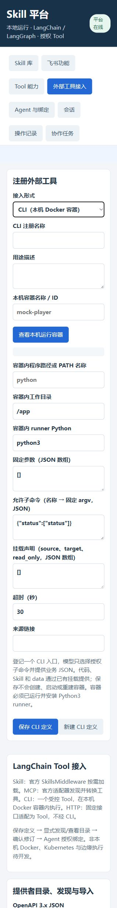

# LangChain 运行时迁移与验证

日期：2026-10-12。已完成代码迁移；以下结果区分真实框架执行、本机模拟协议和真实外部环境。

## 已实施

- Runtime 使用官方 LangChain `create_agent`，由 LangGraph 管理模型/工具循环，采用持久 SQLite checkpointer。原手写循环已移除。
- 消息使用框架消息类型，Tool 使用 `StructuredTool`；内置业务、HTTP 和 MCP 不再经统一 CLI 子进程中转。
- Skill 使用官方 Deep Agents `SkillsMiddleware`，平台提供仅含授权 Skill 的只读 Backend。正文按需读取，解绑/停用后资源读取被拒绝。
- MCP 使用官方 `langchain-mcp-adapters==0.3.2` 与 SDK HTTP 传输；发现、协议会话和 Tool 转换使用官方库，不再维护自研握手实现。
- Docker CLI 只有一个 execute Tool。固定本机 Docker endpoint、容器、程序、工作目录和子命令；JSON stdin、无 TTY、挂载一致性校验。容器内 runner 管理进程组、超时和输出上限。
- 工具登记前端新增类型表单、目录发现/确认、无密钥 JSON 导入导出、OpenAPI 候选操作。保存不启动容器或执行业务。
- 公共权限门禁、绑定版本检查、逐调用审计及未知结果禁止自动重放；保留平台任务/成果数据库和协作调度。
- 父任务使用图中断等待子任务，释放执行槽；聊天框接收 SSE 文本和工具事件，事件 ID 支持重连，终态先排空分页事件再结束。

## 测试记录

完整回归执行命令：

```powershell
.\.venv\Scripts\python.exe -m unittest discover -s tests -v
```

完整回归：59 项，58 项通过，1 项真实 Docker 测试跳过，耗时 84.267 秒。日志位于 `.runtime/framework-final.log`。随后增加两项最终审查测试，并运行全部新增框架用例，最终审查用例共 16 项，15 项通过、1 项真实 Docker 跳过，耗时 26.462 秒，具体结果见 `.runtime/post-review-tests.log`。

| 验证范围 | 执行方式 | 结果与证据 |
| --- | --- | --- |
| 模型/Tool 循环 | 实际 LangChain/LangGraph + 本机模拟 OpenAI 兼容服务 | 多轮消息、工具调用、12 轮上限、输入/输出契约通过 |
| Skill | 官方 middleware + 实际 Skill ZIP/快照与 Backend | 摘要、正文按需读取、只读、越界和撤权检查通过 |
| MCP | 官方 SDK/adapter + 本机 HTTP MCP 测试服务 | 真实协议发现、调用、目录修订与绑定校验通过 |
| HTTP | 实际平台请求客户端 + 本机测试服务 | GET/POST、参数、认证隔离、OpenAPI 支持/拒绝边界通过 |
| 协作 | 实际数据库与调度器 + 模拟模型 | 单执行槽父子等待/恢复、依赖、取消、幂等和范围授权通过 |
| Docker 适配边界 | 模拟 SDK 容器与固定 Docker 客户端调用 | 本机 endpoint、argv/stdin、无 TTY、挂载漂移、子命令限制通过；这不是容器真运行 |
| SSE | 实际平台 HTTP 事件流 | 文本事件、终态和游标重连验证；最终审查补充大于 200 条事件的分页排空 |
| P6 CLI 业务链 | 独立适配脚本真实子进程 + 隔离 mock 服务/数据库 | 4 项通过，包含领取、查询、续租、完成、幂等、失败重试和消费者隔离；不代表 Docker 平台链路已验收 |
| 前端 | 实际浏览器 | 已打开 8770，新 Docker CLI 表单和 JSON 校验预览正常；没有保存测试定义 |
| 静态检查 | compileall、node --check、git diff --check | 通过 |

P6 日志：`P_skill/P6/.runtime/platform-adapter-tests.log`，4 项耗时 5.470 秒。

首次默认沙箱执行受 WinError 10013 阻止，导致本机协议请求失败；改在允许 loopback 的隔离测试环境后重跑。此类环境失败未当作运行时缺陷，也未算作通过。

真实 Docker 验证未执行：没有指定已经运行的测试容器，且按要求不构建 Docker。真实模型供应商、真实飞书公网业务未调用。设置 `PLATFORM_DOCKER_TEST_CONTAINER` 可在可用环境执行真实容器用例；容器需为 Linux、安装 Python3 且已有挂载。

## 旧数据清理与当前服务

用户授权清除旧 Agent/工具定义。先备份到 `.runtime/backups/20261012-151110/platform.db`，随后清理：3 个 Agent、1 个工具绑定、1 个协作授权、4 个会话、20 个后台操作、4 个工具运行记录，以及关联任务/消息/检查点。

保留 1 个已导入 Skill、飞书连接及独立 mock_player 业务数据库。飞书连接不再引用旧 Agent。平台当前 Agent、Tool 提供者、绑定和任务均为 0；用户可从前端重新定义。P6 新 Skill ZIP 与 REGISTER.md 已更新，使用前需重新导入新版 ZIP，不要继续使用旧快照中的独立子工具名称。

当前服务：http://127.0.0.1:8770/。健康信息声明 `runtime=langchain-langgraph`，CLI 执行后端为 `docker-local`。

## 明确的限制

- 非本机 Docker、Kubernetes 和边缘执行未实现；容器部署与镜像构建不由登记页面执行。
- CLI runner 需要 Linux 容器和 Python3。取消阻止后续调用；在途容器动作由自身超时收敛，连接失效时记录结果未知，不宣称已撤销。
- OpenAPI 第一阶段仅支持可映射的 GET 标量查询、POST JSON 与 JSON 响应；不支持的引用、路径参数或认证结构明确拒绝。
- 平台只监听本机并校验 Host/Origin；未新增面向公网的管理员登录系统。


