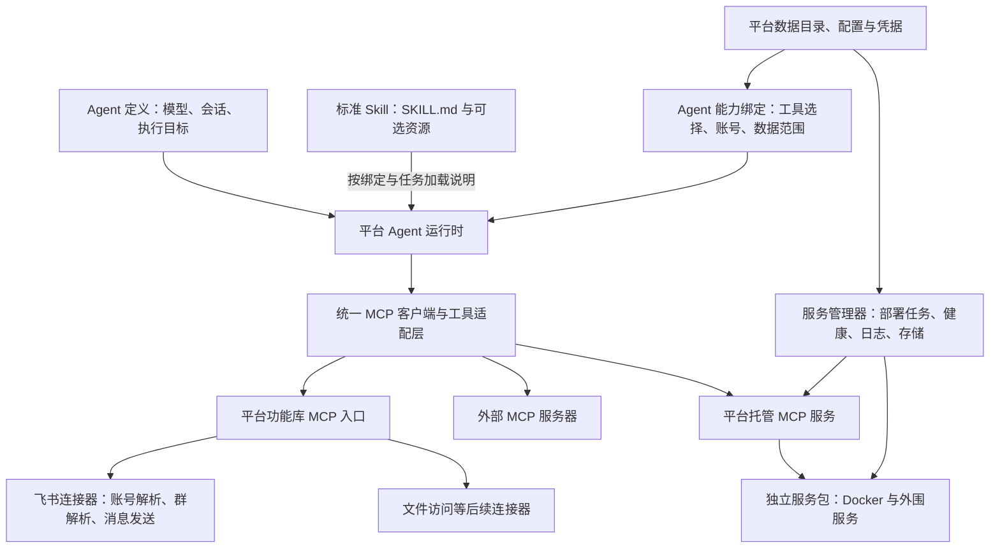

# Skill 平台外围依赖解耦改造方案

日期：2026-10-10  
状态：需求梳理与设计方案，供后续开发使用  
适用项目：industrial_internet_agents / skill 平台

> 实施更新（2026-10-10）：本文保留整体改造设计。根据后续指令，首版本仅在本目录独立构建本地项目，暂不实现 Docker，使用标准库模型工具循环替代第三方 Agent 框架。飞书优先实现并通过 MCP 发布，代码要求全量中文注释。当前完成情况和 23 项测试结果见 `本地版本实施与测试记录.md`，具体运行见上级 `README.md`。

## 1. 目标与本期范围

本次改造将目前绑定在一个 Skill 包内的说明文档、MCP 工具入口、Docker 服务、飞书通道配置和现场存储拆开，形成可独立注册、配置、绑定、启停和升级的对象。

用户已确定的要求：

1. Skill 按标准 Agent Skills 格式构建，移除 Skill 内承担外围 Docker 部署职责的声明与启动文件。
2. 平台新增标准化功能库。第一项实现飞书连通与消息发送；文件访问等功能保留扩展位置。
3. 平台新增独立 MCP 定义与管理。MCP 可以是外部服务器，也可以由平台运行上传的 Docker 服务；需要明确拉取来源、Agent 可见的工具字段，以及文件和信息保存位置。
4. Agent 推送到边缘节点本期不实现，只保留执行目标、部署记录和适配器位置。

本期方案继续沿用现有 Agent 的模型配置、会话和 LangChain/LangGraph 执行框架。迁移既有工业服务时，先保留原业务 API、数据目录和公网入口，再改变平台管理对象之间的关系。

核心验收原则：导入或停用 Skill 不会启动、停止或删除 Docker 服务；删除一个 Agent 的绑定不会关闭其他 Agent 共用的服务。

## 2. 当前代码的耦合关系

现状可概括为：

```text
Agent → Skill 绑定 → skill-package.yaml
                     ├─ tools.catalog + tools.mcp.url/auth
                     ├─ services / deployment / ui / storage
                     └─ controlFile → service_control.py → Compose → 业务服务与 MCP
```

主要依据：

| 现有位置 | 当前行为 | 改造方向 |
|---|---|---|
| `skill/schemas/skill-package.schema.json` | 强制 Skill 声明 tools、MCP、services、deployment 等 | 新 Skill 导入使用标准 SKILL.md 格式；旧工业清单由迁移器处理 |
| `skill/package_validation.py` | 将文档校验、工具契约、镜像、服务健康等放在同一报告 | 分为 Skill 内容校验、MCP 连接校验、服务部署校验 |
| `skill/service_runtime.py` | 从 Skill 清单读取 controlFile 与 MCP 令牌，再执行包内脚本 | 服务管理器读取独立的服务实例配置 |
| `skill/mcp_runtime.py` | 从 Skill 包查地址、工具目录和 Schema；按 Skill 命名工具 | 从 MCP 注册表与 Agent 能力绑定生成工具 |
| `skill/app.py` | 启停 Skill 同时启停外围服务；Agent 从 Skill 绑定获得工具 | Skill 加载、能力授权、服务生命周期分别处理 |
| `a_mac_skill/skill-package.yaml` | 混合文档、业务工具、飞书、Docker、配置页及存储 | 拆成标准 Skill、平台功能配置、独立 MCP/服务包 |
| `a_mac_skill/deploy/`、`scripts/mcp_server.py` | Skill 包携带整个业务服务的运行环境 | 移到独立服务包，作为 MCP 服务的实现与部署材料 |

过去的错误说明了这些边界需要明确：飞书 `cli_...` App ID 与 Gateway 的 `P8P9` 账号 ID 被混用；模型看到的参数 Schema 与执行校验不一致；长时间启停命令在 HTTP 请求中等待结束；业务 Nginx 与平台公网入口容易被理解成同一个生命周期。

## 3. 新架构与职责边界



| 对象 | 负责什么 | 生命周期 |
|---|---|---|
| Skill | 描述任务方法、流程、例子、业务约束和可选资源 | 导入、加载、更新、停用、删除说明内容 |
| 标准化功能 | 定义可复用功能及输入输出、配置和错误语义 | 功能版本、连接器配置、可用状态 |
| 功能连接实例 | 保存某个飞书账号或未来文件根目录的实际配置 | 配置、连通检查、启停连接 |
| MCP 定义 | 描述服务来源、连接方式、Agent 可见工具和存储要求 | 注册、发现、校验、修订 |
| MCP 实例 / 服务实例 | 记录真实地址、凭据引用、容器、卷和健康状态 | 外部连接管理或平台托管服务管理 |
| Agent 绑定 | 决定加载哪些 Skill、可调用哪些功能/MCP 工具、使用哪些账号和数据范围 | 授权、启停、修订；不隐式停止共享服务 |
| 执行目标 | 记录 Agent 将来在哪个节点执行 | 本期仅平台本地，边缘目标预留 |

沿用此前“Agent 工具调用经过 MCP”的要求：标准化功能的内部实现可以是 Python、HTTP 或其他连接器，但面向 Agent 通过平台统一的 MCP 服务发布。外部 MCP 与托管 MCP 也通过同一适配层接入。功能库不是新的 Skill 包仓库。

平台、宿主机 Nginx、ngrok、SSH 隧道由独立的平台运维配置管理；业务 Docker Nginx 只属于相应服务包。停止某个托管 MCP 服务不能关闭平台管理页或远程 SSH。

## 4. 标准 Skill 的格式与加载行为

### 4.1 采用的标准

以公开的 Agent Skills 格式为基线：一个 Skill 目录至少包含 `SKILL.md`，文件包含 YAML frontmatter 与 Markdown 正文；`name`、`description` 为基本必填字段，`scripts/`、`references/`、`assets/` 为可选资源。`name` 与目录名保持一致。

官方标准允许声明兼容性及包含脚本。本项目额外规定：标准 Skill 包不承担平台托管服务的 Docker 编排、凭据注入或服务启停职责。这是平台的职责划分，不应描述成 Agent Skills 标准禁止 Docker。

参考：[Agent Skills Specification](https://agentskills.io/specification)。

### 4.2 目标示例

```text
skills/industrial-workflow/
├── SKILL.md
├── references/
│   ├── monitoring.md
│   ├── work-ticket.md
│   └── communication.md
├── assets/                 # 可选模板、业务资料
└── scripts/                # 可选的任务辅助脚本
```

```yaml
---
name: industrial-workflow
description: 查询工业作业风险、组织工单处置与值班沟通时使用。
metadata:
  version: "1.0.0"
---
```

版本可放在标准允许的 metadata 中，也可由平台记录；不强制额外工业清单作为导入前提。内容摘要、导入来源和安装记录由平台保存。

正文可以解释需要什么能力，以及能力缺失时如何处理。例如“使用当前 Agent 已绑定的飞书发送能力通知值班群”。不写死 MCP URL、端口、Docker 镜像、飞书 App ID、运行目录或令牌。工具的真实名称与参数以平台在本次运行提供的能力目录为准。

`allowed-tools` 如被使用，应遵循宿主支持范围；平台不把它当作授权来源，也不依赖这一实验字段建立部署依赖。Skill 描述需要某种能力，不代表自动获得该能力或自动安装服务。

### 4.3 导入、加载与移除

- 导入：校验 frontmatter、名称与目录、引用边界、ZIP 安全性和内容完整性，保存快照；无需 Docker 或 MCP 连接成功。
- 加载：先向 Agent 提供名称和描述，任务需要时加载正文与引用资源。现有仅注入 Skill 描述的代码需增加正文与按需资源加载。
- 能力检查：根据 Agent 已配置的工具清单展示缺失项；缺失只影响相关任务，不能伪称已执行。
- 停用：后续运行不再加载该 Skill；不停止功能库连接器或 MCP 服务。
- 删除：清理 Skill 注册与相应绑定；服务实例、业务数据和会话数据有独立保留策略。

仅删除现有 Docker 声明而保留旧导入器会导致包无法导入，因此必须先完成新解析器与数据迁移。

## 5. 标准化功能库

### 5.1 功能定义与连接配置分开

功能定义是代码维护的版本化目录，描述功能 ID、显示名称、用途、Agent 输入输出、内部实现、读写性质、超时、错误及幂等策略。连接实例保存现场账号和凭据引用。Agent 绑定保存当前 Agent 可以使用的连接实例。

建议接口形式：

```text
功能定义 feishu.messaging.v1
  → 连接实例 feishu/site-main
  → Agent 能力绑定（连接实例 + 允许目标范围）
  → 平台 MCP 发布工具
```

新增文件访问功能时使用同一注册机制，无需改动工业 Skill。文件功能本期仅定义模块入口和配置契约，不开放实际读写能力。

### 5.2 第一项：飞书连通与消息发送

本期最小能力：

1. 管理飞书连接实例，保存应用信息、内部账号映射及凭据引用。
2. 提供只读连通检查，分别报告凭据、Gateway、飞书 API 和已授权账号状态。
3. 按已配置目录查询群或用户；只有配置映射时明确标记目录来源，不声称查询了整个飞书组织。
4. 发送一条文本消息并返回平台消息 ID、请求 ID 和明确发送状态。

推荐面向 Agent 的参数：

```json
{
  "target": {"type": "group", "name": "动火作业群"},
  "text": "测试消息"
}
```

Agent 已绑定默认飞书连接时不要求模型填写 channel、App ID、Gateway account_id 或凭据。多个连接可用时，只开放获授权的 connectionRef 选项。目标解析支持群名与 chat_id；名称有歧义时返回候选项，不能任选发送。

连接器内部执行稳定映射：

```text
connectionRef → 指定飞书连接实例 → Gateway account_id（例如 P8P9）
群名 / target.id → conversation_id → receive_id_type=chat_id
```

App ID 与 Gateway 账号 ID 分别保存，不能互相替代。现有 a_mac Gateway 可作为首个连接器后端，之后可以增加直接调用飞书 API 的后端；Agent 使用的功能契约保持稳定。

发送响应区分 `sent`、`failed`、`pending`、`unknown`。请求超时不能直接判断“没有发送”；幂等键由平台生成并关联运行记录，结果未知时先查询回执，禁止 Agent 连续盲目重发。

### 5.3 与工业 MCP 的边界

通用飞书查询与发送优先迁入功能库。工业 MCP 保留监测、风险记录、工单、卡片和闭环等业务能力。业务服务在工单流程内发送卡片属于业务内部副作用，可以继续保留。

同一个通用发送动作不同时作为两套默认 Agent 工具开放。迁移期间保留旧工具兼容入口，完成绑定迁移后从默认工具列表移除重复项。

## 6. 独立 MCP 定义与服务管理

### 6.1 来源与运行模式

| 模式 | 提供什么 | 平台负责什么 |
|---|---|---|
| 外部 MCP | 已运行的服务地址与鉴权配置 | 连接、发现、测试、授权、健康状态；不启动或停止外部服务器 |
| 镜像仓库拉取 | imageRef、版本/摘要、容器启动配置 | 拉取、校验、启动、健康、日志与持久卷 |
| 本地上传镜像 | Docker/OCI 镜像归档及启动配置 | 保存原件与摘要、导入镜像、创建服务实例 |
| 本地上传服务包 | Compose、多容器定义、代码与必要构建文件 | 校验服务包、构建/拉取镜像、启动完整服务集合；用于迁移现有 a_mac |

上传 Docker 文件不意味着它已经暴露 MCP。必须另行声明 MCP 传输与容器内监听地址，并实际完成工具发现。

本期接入优先支持 Streamable HTTP 的外部与 Docker MCP。stdio 保留在传输适配器接口中，需要时另行实现和验收，不能显示为已支持。连接地址不强制以 `/mcp` 结尾；地址应按服务实际配置使用。协议版本协商跟随 MCP SDK，与 Skill 内容版本、功能版本和 Docker 镜像版本分开记录。

### 6.2 配置字段

下列字段属于平台 MCP 定义或服务实例，不进入 Skill 包：

| 字段组 | 关键字段 | 说明 |
|---|---|---|
| 标识 | id、name、description、revision | 定义身份与修订；服务用途供管理员识别 |
| 来源 | source.kind、sourceUrl、imageRef、artifactId、digest | sourceUrl 为下载/来源链接；imageRef 为镜像仓库引用；artifactId 为本地上传对象 |
| 连接 | transport、endpointUrl、auth.kind、secretRef、timeout | endpointUrl 是真正 MCP 连接地址，与拉取链接分开；支持无认证或相应认证适配 |
| Docker 运行 | command、args、env/secretRefs、ports、networks、resources | 本地服务启动与限制；敏感配置由平台注入 |
| 多服务包 | bundleRef、serviceGraph、buildRefs | 外围服务依赖图仅存在于服务包管理对象 |
| 存储 | volumeRefs、mounts、artifactPolicy、retention | 明确主机路径/卷与容器路径、读写权限和保留规则 |
| 工具展示 | selectedTools、displayName、agentDescription | 从发现结果选择工具；可调整用途说明，但不能任意改写执行参数 |
| 工具契约 | discoveredSchema、approvedSchema、schemaRevision | 校验模型可见字段与真实调用契约是否一致 |
| 配置页面 | configurationPages、publicPath、authPolicy | 保留服务配置页，由服务实例向前端提供链接 |
| 健康 | connectionCheck、readinessCheck、lastError | 分开展示容器状态、MCP 协议可用和业务能力状态 |
| 管理边界 | ownership、sharePolicy、executionTargetRef | external 或 managed；共享服务与执行目标明确 |

应支持“可选文件/信息保存目录”而非要求所有外部 MCP 必须使用本地磁盘。没有本地文件输出的 MCP 可以不配置卷，只记录调用审计和保留策略。

### 6.3 Agent 可见字段与执行字段

MCP `tools/list` 的名称、描述和输入 Schema 是真实工具契约的来源。平台可以提供友好描述、选择工具和收窄权限，但任何输入改写必须由显式适配器映射并验收。

Agent 只看到业务输入，例如群目标和消息；连接实例、凭据、主机路径、执行身份与幂等请求 ID 由平台绑定注入。原始 MCP 如果明确需要 account_id，而平台没有映射适配器，就按原 Schema 给出受允许的值，不能直接隐藏必填字段。

发现新 Schema 后先生成待确认修订，验证完整嵌套字段和实际调用方式，再更新授权目录。不能让模型使用旧字段、执行器使用新字段。更新期间正在执行的调用保持原修订，后续运行加载新修订。

错误向 Agent 返回可辨别的状态，例如 `PARAMETER_INVALID`、`ACCOUNT_NOT_FOUND`、`AUTH_FAILED`、`SERVICE_UNAVAILABLE`、`RESULT_UNKNOWN`；保留错误正文中允许披露的信息，避免只剩 HTTP 404。参数错误不触发自动重试。

适配层应处理标准 MCP 的文本、结构化结果及其他内容类型，不继续把所有工具输出强制当作 JSON 对象。功能库可以采用稳定结构化响应，外部 MCP 保持协议内容并通过平台的展示与文件保存适配处理。

MCP 的通信职责参考：[MCP Architecture](https://modelcontextprotocol.io/docs/learn/architecture)。Docker 部署、目录管理和权限绑定属于平台实现。

### 6.4 服务生命周期

运行管理统一使用任务对象：`POST` 返回 operationId 与受理状态；后台执行拉取、构建、启动、停止和健康检查；前端查询进度或订阅事件。

任务状态建议为 `queued → running → succeeded / failed / cancelled / interrupted`，记录阶段、日志位置和错误。平台重启后核对未完成任务与实际容器状态，不能直接把数据库中的 running 当作成功。

同一服务实例的变更串行执行，重复点击返回既有任务或操作冲突。停止共享服务时提示当前引用与在途调用；停用某个 Agent 或 Skill 不触发停止共享容器。外部 MCP 的停用只切断本平台的使用资格。

容器正在停止或构建时，平台页面、注册表和状态接口继续响应。长任务不放在数据库写事务中，也不由浏览器维持一条请求来等待所有步骤结束。

## 7. 文件、信息与凭据保存位置

建议平台内部采用以下逻辑目录；实际根路径由平台实例配置，不写入标准 Skill：

```text
platform-data/
├── platform.db                 # 注册、绑定、会话、任务与索引
├── skills/<content-digest>/    # 标准 Skill 内容快照
├── uploads/<artifact-id>/      # 上传的镜像、服务包与来源信息
├── mcp/<instance-id>/
│   ├── config/                # 配置修订；密钥只保存引用
│   ├── logs/                  # 构建、启停与运行日志
│   └── data/                  # 平台管理的持久目录（如适用）
├── functions/<connection-id>/  # 功能连接器非敏感配置与目录缓存
├── artifacts/<artifact-id>/   # 工具生成的文件与下载索引
└── secrets/                   # 受限凭据后端，管理页面不回传值
```

区分三类信息：

- 平台信息：Agent 配置、会话、工具调用、服务任务和审计，归平台保存。
- 服务业务数据：工单、监测记录、Gateway 数据等，归服务实例的持久目录管理；现有现场数据迁移前按原路径保留。
- 工具产物：导出文件、图片、报告等，以 artifactId、来源工具、大小、摘要和访问范围记录；模型获得引用或获授权的下载位置。

远程 MCP 返回一个文件路径，不代表平台或用户能够访问。仅在服务提供标准内容/资源读取方式或明确的下载 API 时才能接收为平台产物；否则提示“远端路径，尚未获取文件”。本地 Docker 产物需要明确的容器路径到受控卷的映射。

未来文件访问功能以授权根目录为边界，配置读/写模式和产物目录，不开放任意主机路径。Skill 脚本获得文件访问能力也必须遵守 Agent 的授权范围。

停止、解绑默认保留数据；卸载时显式处理镜像、运行配置、卷和产物，不能把删除 Skill 当作删除业务数据。

## 8. Agent 配置与绑定模型

```text
Agent
├─ 模型与系统提示词
├─ Skill 绑定（一个或多个标准 Skill）
├─ 功能绑定（功能 + 连接实例 + 目标/数据范围）
├─ MCP 工具绑定（服务实例 + 工具白名单 + 配置修订）
└─ executionTargetRef（本期 platform-local）
```

Skill 和功能/MCP 均可单独绑定；不使用任何 Skill 的 Agent 也可以获得获授权的工具。纯说明 Skill 可以在无 MCP、无 Docker 环境中正常加载。

平台在一次运行开始时生成能力目录，包括名称、用途、完整输入字段、配置注入关系和可用状态。工具前缀改为基于能力来源和实例的稳定命名空间，不再依赖某个 Skill 的名称。多个 Skill 使用同一飞书连接时只注册一次工具。

每次真实执行重新校验绑定与权限；会话历史里出现过工具名不代表现在仍获授权。绑定暂停、服务停止、连接失效、Skill 停用分别显示，避免一个 enabled 字段代表所有状态。

## 9. 数据模型、模块与 API 改造

### 9.1 数据模型建议

| 对象/表 | 关键数据 |
|---|---|
| skill_definitions、agent_skill_bindings | 标准元信息、内容摘要、内容位置、加载状态 |
| function_definitions、function_connections | 功能契约、版本、连接配置与凭据引用 |
| mcp_definitions、mcp_instances | 服务来源与真实运行实例、配置修订、ownership |
| tool_descriptors | 来源、完整 Schema、可见描述、修订与发现状态 |
| agent_capability_bindings | Agent、来源实例、工具白名单、注入配置、权限范围 |
| storage_bindings、artifacts | 卷与路径关系、产物归属与保留策略 |
| operations、operation_events、tool_runs | 后台管理任务、阶段事件、调用与回执 |
| execution_targets、agent_deployments | 本地目标与未来部署记录位置；边缘执行预留 |

以上为逻辑对象，可按项目规模合并物理表，但不能合并回“所有配置存在 Skill manifest”。

### 9.2 模块建议

```text
skill/                         # 现有平台代码，逐步拆分
├── skill_store/               # 标准 Skill 解析、校验、快照、按需加载
├── capability_registry/       # 功能、MCP 工具与 Agent 授权绑定
├── function_library/feishu/   # 第一项标准化功能
├── mcp_registry/              # MCP 定义、实例、发现与契约修订
├── mcp_runtime/               # 协议客户端与模型工具适配
├── service_manager/           # 本地 Docker/服务包生命周期
├── operation_runner/          # 后台任务与恢复核对
├── storage_manager/           # 文件、卷、产物与保留规则
└── execution_targets/         # local 实现、edge 接口占位

skills/industrial-workflow/    # 新标准 Skill
service_bundles/industrial-workflow/  # 原业务后端、MCP 与 Docker 构建材料
```

模块名称是建议，开发时可以沿用现有文件逐步提取，不要求一次重写全部目录。

### 9.3 API 与前端

建议新增 `/api/functions`、`/api/function-connections`、`/api/mcp-definitions`、`/api/mcp-instances`、`/api/capability-bindings`、`/api/operations`、`/api/artifacts`。

`/api/skills` 改成标准 Skill 内容操作。服务启停放在 MCP/服务实例接口，返回后台 operationId。健康接口区分平台健康、实例健康与工具可用。外部 MCP 提供连接测试；托管实例提供拉取/构建、启动、停止和日志。

前端增加三个独立入口：

1. Skill 库：上传/导入、查看说明、版本、Agent 绑定和加载状态。
2. 功能库：查看功能、创建飞书连接、配置账号与目标范围、测试连接和发送测试。
3. MCP 服务：注册外部地址或上传/拉取 Docker 服务，配置存储与展示字段，发现工具、绑定 Agent、查看部署任务与健康。

Agent 配置页独立选择 Skill 和能力。Skill 列表移除“运行方式”“停止全部服务”和业务服务配置页链接；对应操作移入 MCP/服务实例管理。平台运行状态固定独立显示，不因业务服务停止而变成“平台离线”。

## 10. 既有 a_mac_skill 的迁移

| 旧包内容 | 目标位置与处理 |
|---|---|
| SKILL.md、业务 references、适用 assets | 整理为 `skills/industrial-workflow/`，更新引用；去掉部署入口与现场值 |
| skill-package.yaml 中 Docker/services/deployment/lifecycle | 转为独立 MCP 定义、服务包与服务实例记录 |
| skill-package.yaml 中 ui | 移到服务实例的配置页定义 |
| deploy/、Dockerfile、Compose、service_control.py | 移入 `service_bundles/industrial-workflow/`，由服务管理器调用 |
| scripts/mcp_server.py、scripts/client.py、业务后端源码 | 归独立工业 MCP 服务的实现与构建上下文 |
| tools/catalog.yaml、请求/响应 Schema | 归 MCP 工具契约或标准化功能定义；逐项与发现 Schema 核对 |
| schemas/config.schema.json、现场 .env 引用 | 移到服务/连接实例配置；密钥迁入平台凭据引用 |
| package.lock.json | 新标准 Skill 不再强制携带；平台记录内容摘要，服务包另有完整性记录 |
| 通用飞书发送与群查询 | 迁入功能库，绑定实际账号映射，保留必要兼容入口 |
| P6/P7/P8P9 数据 | 保留现场原目录，先建立明确存储绑定，再进行单独数据迁移 |

新 Skill 目录使用标准名称 `industrial-workflow`；原 `a_mac_skill` 作为迁移来源与回退材料保留，完成验证后移除其作为新 Skill 的入口资格。

迁移顺序：

1. 备份本地源码、平台数据库、配置、包快照与现场数据清单，记录当前镜像和网络。
2. 增加独立注册表、新 Skill 导入路径和迁移器，旧路径暂时兼容。
3. 从旧工业清单创建服务定义、MCP 实例、工具目录与存储映射，保留真实现场配置。
4. 创建标准 Skill 与独立 Agent 能力绑定，迁移飞书连接映射。
5. 校验新绑定与工具 Schema；只读探测先通过，再执行有明确目标和回执的写操作验收。
6. 切换 Agent 运行时至新绑定；旧快照只作回退来源。按迁移记录回退时恢复旧配置与绑定，不覆盖新业务数据。
7. 从新的标准 Skill 包删除原部署声明与控制入口；新导入器不再要求工业清单。

实施继续遵守已有流程：修改代码在本地完成，再同步至 Mac，最后按受影响对象重建容器或重启平台。此次文档工作不构成部署执行。

## 11. 边缘 Agent 的预留

本期支持的实际执行目标只有 `platform-local`。保留：

- `executionTargetRef`：Agent 运行目标。
- `execution_targets`：目标 ID、kind、endpointRef、能力、状态等；可记录 edge 类型为 unavailable。
- `agent_deployments`：Agent 配置修订、目标引用、状态及部署记录的位置。
- 执行目标适配器接口：将来负责下发配置、启动、停止和状态查询；本期 edge 适配器明确返回未实现。

MCP 服务器位于边缘机器，只表示工具服务的访问位置；不代表 Agent 已经部署到边缘。

本期不实现边缘节点代理、Agent 打包下发、远程安装、密钥分发、边缘会话状态同步、离线运行或远程容器调度。前端可显示预留说明，不提供可误触发的“已部署”状态或无效部署按钮。

## 12. 开发阶段与验收

| 阶段 | 交付 | 通过条件 |
|---|---|---|
| A：冻结边界 | 标准 Skill 格式、功能/MCP/实例/绑定对象、迁移方案 | 普通 SKILL.md 无工业清单也能导入；纯说明加载不依赖 Docker |
| B：独立 MCP | 外部连接、工具发现、嵌套 Schema、绑定和独立状态 | 一个 MCP 可供多个 Agent 使用；Skill 停用不停止它 |
| C：托管服务 | 镜像拉取/上传、多服务包、后台任务、存储与配置页 | 构建/停止时平台接口保持可访问，操作可跟踪且不影响外层入口 |
| D：飞书功能 | 连接实例、目录解析、账号映射、发送与回执 | 群目标与账号不混淆；发送一次获得实际回执；错误可定位且不盲重试 |
| E：工业迁移 | 标准 industrial-workflow Skill 与独立工业 MCP | 原监测/工单能力可用，现场数据保留，重复通用工具清理，回退可执行 |
| F：扩展预留 | 文件访问注册接口、执行目标抽象与 edge 占位 | 未实现能力不开放；不要求开发边缘 Agent 下发 |

具体回归场景：

1. 没有 Docker 和 MCP 时导入普通标准 Skill，成功读取其说明。
2. Agent 只绑定功能/MCP、未绑定 Skill，仍能调用获授权工具。
3. 两个不同 Skill 复用同一飞书连接；移除任一 Skill 不关闭连接。
4. 外部 MCP 注册不拉取镜像；上传镜像未运行时只显示已保存，不能显示 MCP 就绪。
5. 本地镜像拉取链接、服务连接地址、宿主机卷和容器路径分别保存与展示。
6. tools/list 的嵌套字段与 Agent 实际参数一致；填错 conversation_id 或账号返回明确错误。
7. 网关 401、账号不存在、飞书 API 拒绝、超时与结果未知分别报告，不统一称通道不可用。
8. 多次点击启停不会产生相互竞争的任务；执行期间 GET 平台页面/状态接口正常。
9. 停止业务 Docker 服务后平台、外层 Nginx 和 SSH 保持可用；业务页面显示相应服务未运行。
10. 产物保存符合授权路径；远程路径不会被直接当成本地文件。
11. 数据库迁移与回退保留既有会话、Agent 配置、工单和原现场卷。
12. 将 executionTargetRef 指向 edge 时明确返回本期不支持，不触发下发动作。

本期验收完成后，平台的组合单位是“Agent 配置 + 标准 Skill + 功能/MCP 能力绑定”；Docker 与网络服务由独立服务管理模块负责。后续增加新的 Skill、功能或 MCP，无需重新打包另一方。
