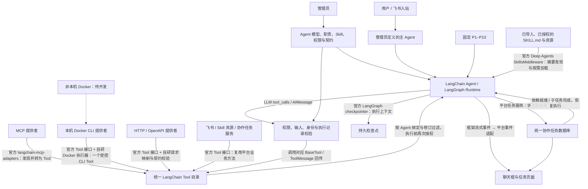

# 多智能体协同开发思路

> 架构修订：2026-10-12。本文件记录目标架构、迁移计划和测试设计；运行时迁移已实施，实际验证见《LangChain运行时验证》。取代原“所有能力必须经过统一 CLI”的设计。现有代码使用 LangChain/LangGraph，历史自有 Runtime 实施结果见《本地版本实施与测试记录》和 README。

## 一、目标与范围

管理员预定义主 Agent 和 P1–P10，配置职责、模型、Skill、输入输出契约、并发和协作权限。运行时创建任务，不创建新 Agent。主 Agent 安排任务、读取授权成果并汇总；平台负责依赖、执行和审计。

模型能力入口统一为 LangChain Tool。MCP、Docker CLI、HTTP、平台内置功能分别适配为 Tool，不再统一转换为 CLI。Skill 是知识与流程，其读取和关联工具使用官方 SkillsMiddleware；Skill 本身不等同于可执行工具。

- Agent 基座采用 LangChain / LangGraph；优先复用 Deep Agents 的 SkillsMiddleware，按需选用完整 Deep Agents harness，避免无意开放其默认规划、子 Agent、文件写入和执行能力。
- CLI 只支持本机 Docker 容器内执行，禁止宿主机业务 CLI 直跑。非本机 Docker、SSH、Kubernetes、边缘执行均待开发。
- MCP 与 HTTP 是独立工具适配路径，不受“CLI 只能在 Docker 内执行”的限制，也不经 CLI 转译。此前对两者默认关闭的建议被本次三类统一 Tool 架构取代。
- 平台自身模型运行、任务调度和数据库访问不要求进入业务容器。Docker 限制针对外部 CLI 工具执行。
- 不要求当前机器成功构建 Docker；实现、协议测试与真实 Docker 验收必须分别报告。

## 二、架构图与官方支持方式

连接线标注官方组件或需要开发的适配层，不能把自研 Docker 执行器标成框架自带能力。

官方依据：

- [LangChain create_agent](https://docs.langchain.com/oss/python/langchain/agents)：模型与工具循环；基于 LangGraph。
- [LangChain Tools](https://docs.langchain.com/oss/python/langchain/tools)：使用 @tool / BaseTool 等接口封装能力和参数。
- [Deep Agents Skills](https://docs.langchain.com/oss/python/deepagents/skills)：SKILL.md、渐进加载、SkillsMiddleware 与关联工具解析。
- [LangChain MCP](https://docs.langchain.com/oss/python/langchain/mcp)：当前文档 MCPAdapter / list_tools，langchain[mcp]>=1.4.0，Beta；旧版为 langchain-mcp-adapters。实施前锁定实际可安装版本并验证 API，不混用两套接口。
- [Deep Agents Backends](https://docs.langchain.com/oss/python/deepagents/backends)：后端和 execute 扩展。LocalShellBackend 在宿主机执行，不符合本项目 CLI 限制；本机 Docker 路径需自行实现。
- [LangGraph Persistence](https://docs.langchain.com/oss/python/langgraph/persistence)：检查点与恢复，不能替代平台任务授权和业务数据。

## 三、Agent、Skill 与 Tool 的职责

### 3.1 Agent 定义与运行

保留 Agent ID、system_prompt、model、base_url、密钥引用、skill_ids、输入输出 Schema、concurrency、timeout 和配置版本。用官方模型适配器建立模型；每个任务构建授权 Tool 集合。不会在 system_prompt 中继续强制“所有调用经过 CLI”。

消息使用 SystemMessage、HumanMessage、AIMessage、ToolMessage。模型返回工具调用时，执行对应 Tool，再把工具结果送回模型。保留轮数、总时限与取消控制，不能用框架默认循环替代平台限制。

优先使用 create_agent 配合 SkillsMiddleware 和持久 checkpointer。若父子任务等待要求自定义控制流，则增加 LangGraph 编排节点；实现阶段先做最小验证，不同时维护两个独立 Agent 循环。

### 3.2 Skill 导入和运行时加载

平台继续负责 ZIP/目录导入、frontmatter 基础校验、内容快照、资源引用、版本和权限。SkillsMiddleware 负责运行时识别目录、摘要注入和按需加载，不负责管理页面上传与权限审批。

按 Agent 绑定版本构建只读 Skill 视图，仅包含授权目录。不能把全部平台 Skill 放进公共目录后仅靠提示词限制访问。资源路径检查仍在平台后端；禁止 ../ 和符号链接绕过。

关联工具使用 middleware 的工具解析机制映射到平台稳定工具标识，并与当前 Agent 授权取交集。Skill 的 include_tools 不是授权依据。不默认开放写文件、动态创建 Agent 或任意命令执行。

### 3.3 工具目录与权限

工具具有稳定 ID、提供者 ID、来源工具名、模型工具名、用途、输入 Schema、输出契约、超时、修订及副作用策略。输出契约主要在平台执行后校验，不假定所有模型接口支持 output_schema。

模型名称需要符合模型供应商命名限制，采用短前缀和稳定摘要避免多提供者同名冲突。授权按稳定 ID 与修订保存，不依赖展示名称。每次执行重新检查启用状态、绑定和修订；身份从运行上下文注入，模型不得指定 caller_agent_id 或凭据。

成功/失败结果统一为结构化回执，内部保留原协议细节，给模型提供清晰错误；避免旧双层 envelope 导致外层成功、内层失败被误判。参数错误可以交回模型修正；外部动作超时或结果未知不可自动重试。

## 四、三类外部提供者的登记设计

统一“提供者 → 工具目录 → Agent 绑定”，不要求三类接入填写相同表单。

### 4.1 MCP

填写名称、连接地址、凭据引用、超时。第一阶段沿用 HTTP/HTTPS 连接范围；框架支持其他传输不意味着平台自动开放宿主机 stdio 进程。

管理员保存定义不发起连接。点击“发现工具”启动后台操作，用官方 MCPAdapter 拉取目录、归一化、校验并显示差异。管理员确认并选择允许工具后生成目录修订。连接状态与工具授权状态分开；工具发现失败保留上一份目录，但标注失败时间。

客户端由平台管理生命周期，异步执行并支持关闭；不在每次页面刷新时发现工具。MCP 目录变化不自动授予新工具。删除或改 Schema 的工具使对应旧绑定待确认。

### 4.2 本机 Docker CLI

登记一个 CLI 入口，不再逐项登记 P6 的 11 个子命令为模型 Tool。平台生成一个 cli_<provider> 工具，输入为允许子命令、参数数组或业务 JSON；具体用法来自 Skill 和经过管理员确认的 CLI 帮助。

登记字段：名称、用途、本机容器选择、容器内 executable、working_directory、固定 argv、允许子命令/参数规则、stdin 模式、stdout 模式、超时和凭据引用。程序名称可按容器内 PATH 解析；保存解析结果供管理员核对，不使用宿主机 PATH。

Docker 容器、挂载属于执行配置：记录容器身份、镜像信息及宿主路径到容器路径的挂载映射，校验实际容器配置一致。挂载默认只读代码与 Skill、可写 data；正常登记不自动创建容器或新增挂载。已有容器挂载不能用 docker exec 临时修改，变更挂载需要明确的容器重建流程。

宿主机 Docker 连接由管理员部署配置固定，禁止请求或模型切换 DOCKER_HOST、远程 context、特权参数或挂载 Docker socket。检验实际 endpoint 为本机，远程目标返回 NOT_IMPLEMENTED。

执行器通过 Docker SDK 的 exec 接口或固定 docker exec argv 实现。固定容器、工作目录，保持 stdin，不分配 TTY；stdout 和 stderr 分开，日志不混入 JSON。绝不将模型输入拼成 shell=True 命令。

可选“读取帮助/目录”由管理员显式触发，在同一容器执行预设 --help 或 catalog --json。帮助说明可供模型理解，但不自动解析成精确 Schema；机器目录用于验证子命令规则和展示，不强制生成一工具一子命令。

超时/取消必须验证容器内进程终止：设计容器侧受控 runner，使用 invocation_id 和进程组管理，避免只关闭 Docker 客户端。终止无法确认时记录结果未知，不宣称取消成功。模型不可访问 runner 的任意 kill 或容器管理接口。

P6 CLI 内部访问 mock_player HTTP 数据服务是业务实现，与平台 HTTP 工具入口无关。沿用同一 mock 数据库与消费者身份，身份及服务地址使用固定配置。

### 4.3 HTTP

支持手工登记操作与导入 OpenAPI 文档。声明 base_url、认证引用、method、path、路径/查询/JSON body 参数、响应映射和超时。OpenAPI 导入生成候选操作，管理员确认后发布，不直接授予全部操作。

使用官方 Tool 接口包装现有请求客户端；HTTP 直连不会转译为 CLI。固定服务范围、禁止模型指定任意 URL 或认证 Header，重定向也需检查目标。对暂不支持的 OpenAPI 特性明确报错，不能静默生成错误工具；第一阶段限定 JSON 请求/响应，上传、回调和复杂组合 Schema 分阶段开发。

## 五、前后端重新设计

### 5.1 页面流程

1. 外部工具列表按 MCP / Docker CLI / HTTP 分组，显示连接状态、目录修订、工具数量和授权情况。
2. 选择类型后显示对应表单；Docker CLI 不出现宿主机解释器绝对路径字段，只显示容器内程序和目录。
3. 保存提供者草稿。MCP 提供“发现工具”；CLI 提供“读取帮助/目录”；HTTP 提供“导入 OpenAPI / 添加操作”；各类型均提供声明 JSON 导入导出。
4. 目录预览展示新增、删除与契约差异，管理员确认发布。默认不执行业务测试。
5. Agent 页面选择提供者与工具，保存绑定修订；CLI 选一个入口及其子命令权限，Skill 独立绑定。
6. 显式测试按钮区分连接/帮助检查和真实业务调用，展示结果、耗时及审计 ID。列表刷新不启动程序、不调用模型。

长操作返回 operation_id，通过有界轮询读取进度；聊天和任务执行事件另用 SSE。错误保留编辑内容，敏感信息只展示是否已配置，不能回填密钥。

### 5.2 拟新增管理 API

| API | 职责 |
| --- | --- |
| POST /api/tool-providers | 保存提供者草稿，不运行命令 |
| GET/PATCH /api/tool-providers/{id} | 查看或修订配置 |
| POST /api/tool-providers/{id}/discover | 显式发现或读取目录，返回操作 ID |
| POST /api/tool-providers/{id}/catalog/confirm | 按预期修订确认候选目录 |
| POST /api/tool-providers/import | 校验并预览声明，不立即绑定或执行 |
| GET /api/tool-providers/{id}/export | 导出无密钥配置，保留凭据引用占位 |
| POST /api/tool-providers/{id}/test | 管理员显式测试，记录审计 |
| POST /api/bindings | 保留入口，改用稳定工具 ID 和目录修订 |
| GET /api/sessions/{id}/events | SSE 输出文本增量、工具事件、任务状态及错误 |

所有写 API 执行平台管理员认证；这不能依赖浏览器按钮隐藏。修订使用条件更新，防止旧页面覆盖新配置。旧 MCP/cli-services/http-services API 在迁移期只做配置转换，禁止借旧 CLI 路径继续宿主机执行。

### 5.3 持久化

继续使用 SQLite 保存 Agent、Skill、业务 tasks、依赖、成果和审计。新增逻辑对象 tool_providers、tool_catalogs、绑定修订与迁移记录；根据现有 Store 的对象存储结构实现，不因文档命名强行新建同名物理表。

LangGraph 检查点使用持久 SQLite 后端，建议独立 checkpoints.sqlite3，避免框架与业务表生命周期混淆。以平台 task_id 作为 thread_id，配置版本进入检查点元信息。不得把 API Key、完整环境变量或敏感 Header 放入检查点和 SSE。

协作任务状态仍是 queued/running/waiting/succeeded/failed/cancelled/interrupted。checkpointer 不负责权限和业务完成判定。重启恢复先核对副作用工具的执行记录，存在结果未知时进入 interrupted/人工核对，不自动重放。

## 六、项目代码迁移计划

本节保留实施清单；对应运行时、Tool 适配、Skill 和登记页面已实施，下面的规划边界与实际限制见第八节。

| 现有位置 | 计划调整 |
| --- | --- |
| platform_core/runtime.py | 替换手写模型循环；使用框架消息、流式执行、checkpointer 与平台事件适配 |
| platform_core/agents.py | 保留定义、权限和绑定；catalog 返回 BaseTool，execute 进入公共授权执行层 |
| platform_core/skills.py | 保留导入与快照；提供授权只读 Backend / SkillsMiddleware 视图 |
| platform_core/mcp.py | 保留管理配置，发现和调用替换为官方适配器；移除手写协议调用重复部分 |
| platform_core/external_cli.py | 转为 Docker-only 适配器；删除宿主进程执行能力，迁移旧声明 |
| platform_core/direct_http.py | 复用 HTTP 校验和请求逻辑，生成 Tool，补充 OpenAPI 候选导入 |
| platform_core/cli_bridge.py、cli.py | 不再是 Agent 必经路径；保留管理员 CLI 或明确废弃的旧兼容接口 |
| platform_core/tasks.py、scheduler.py | 保留业务调度；接入图暂停/恢复与子任务通知，等待时释放槽位 |
| platform_core/task_store.py、storage.py | 新目录与迁移记录，图检查点关联、工具执行幂等记录 |
| platform_core/service.py | 组合新目录、工具适配器和框架 Runtime，管理异步资源关闭 |
| platform_core/collaboration_api.py、app.py | 新提供者 API、后台发现和 SSE；迁移旧接口并封堵宿主执行 |
| web/external-access.js、index.html | 类型向导、发现/导入、目录预览、Docker 选择与修订确认 |
| web/binding-controls.js、app.js、collaboration.js | 新工具绑定、流式聊天事件、授权过期及等待状态 |
| P_skill/P6/integration、REGISTER.md | 旧 11 工具定义转为一个 Docker CLI 提供者；更新生成器、部署配置和登记说明 |

拟新增模块：tool_registry.py（提供者/目录）、tool_adapters/（builtin/mcp/docker_cli/http）、skill_backend.py（授权视图）、model_factory.py、runtime_events.py、docker_runner/。按职责拆分，不把所有协议代码塞进 Runtime。

新增项目依赖清单与锁文件，包含 LangChain、LangGraph、Deep Agents、模型适配包、持久检查点包和 Docker SDK；准确版本由最小兼容验证确定。MCP 只选一套已验证官方接口。标准库 HTTP 服务暂时沿用，框架异步资源使用服务级事件循环，禁止每次请求新建并立即关闭 MCP 客户端所在事件循环。

### 6.1 实施阶段与退出条件

1. **框架最小验证**：锁定版本，验证模型 Tool 循环、SkillsMiddleware、MCP发现、持久检查点和流式事件。确认普通 create_agent 挂 middleware 所需 Backend 与读文件工具，避免漏掉必要依赖。
2. **目录与迁移**：实现新 Provider/Tool 契约、导入预览、修订和授权。旧 CLI 标记 migration_required 并禁用执行，不能自动把 Windows 路径猜成容器路径；旧 HTTP/MCP 配置可转换并要求重新确认。
3. **执行适配器**：内置 Tool、官方 MCP、HTTP、Docker CLI 按模块实现；完成统一回执和权限门禁。
4. **框架 Runtime**：接入任务、检查点、子任务等待和取消。等待通过持久中断或图节点状态释放执行槽；外部通知恢复时必须匹配暂停位置，不重复调用 submit_task。
5. **前端与 P6**：接入向导、目录、授权、SSE；更新 P6 Skill 的实际工具名与 CLI 使用示例，废弃旧逐项注册说明。
6. **验收与清理**：回归业务与迁移，真实模型及 Docker 在可用环境验证，最后删除旧 Agent 强制 CLI 路由。

迁移先备份业务 DB 与配置。不能一边运行旧任务一边换其执行上下文：停接新任务、处理或中断在途任务，再升级。旧检查点保留只读审计，不直接转换为 LangGraph 状态。回滚需要相同数据版本边界，不能默认恢复旧版本后重新开放宿主 CLI。

## 七、测试设计

各层测试必须使用隔离数据库、测试提供者与临时配置，不调用真实飞书业务动作。旧 42/45 项通过记录是历史结果，不能当成新架构测试已通过。

| 层级 | 场景 | 必须断言 |
| --- | --- | --- |
| 目录与管理 API | 保存、导入、导出、冲突、修订、删除 | 保存不执行；无密钥导出；旧修订不能覆盖或继续授权 |
| Skill | 元信息、按需读取、引用资源、关联工具 | 初始只有摘要；只读授权目录；越界/未绑定资源拒绝；关联不能扩大权限 |
| 模型循环 | 无工具结束、一轮/多轮、多调用、非法参数 | 消息角色与 tool_call_id 正确；JSON 校验；轮数/时限生效 |
| MCP | 测试 MCP Server 的发现与调用、同名工具、目录变化 | 官方真实协议链路；名称稳定；新增工具未授权；断连与关闭正确 |
| HTTP | 路径/查询/body、认证、响应、超时、OpenAPI | 固定服务范围；Header 不外泄；错误不当成功；不支持特性明确拒绝 |
| Docker 协议单测 | 模拟 SDK，容器身份、argv、stdin/stdout | 不触发宿主 CLI；无 TTY；参数不经过 shell；远程 endpoint 拒绝 |
| Docker 真集成 | 已运行测试容器，PATH/工作目录、中文、取消 | 容器内实际运行；宿主哨兵未触发；超时后目标进程确实结束 |
| 权限与身份 | 停用、撤权、篡改工具/身份、Schema/修订变化 | 执行时再次校验；伪造身份无效；模型不能更改容器或服务地址 |
| 幂等与恢复 | 完成后崩溃、调用中断、回执未知、再次恢复 | 已确认动作不重复；未知动作不自动重发；无全局缓存误去重合法重复调用 |
| 多 Agent 协作 | 单槽父子等待、依赖、循环授权、取消 | 等待释放槽位；完成只恢复一次；结果权限隔离；无死锁 |
| SSE/前端 | 文本增量、工具开始/结束、等待、重连、报错 | 事件 ID 有序、重连去重；不展示密钥；文字和工具状态一致 |
| P6 端到端 | 领取、查询、续租、完成、失败重试、无任务 | 所有工具执行来自容器；同一 mock DB；状态/证据可追溯；单一 CLI Tool |
| 迁移 | 老配置与绑定、缺容器、旧检查点 | 旧宿主路径不执行；显式待迁移；备份可核对；配置不丢失 |

建议新增 tests/test_tool_registry.py、test_skill_middleware.py、test_langchain_runtime.py、test_mcp_adapter.py、test_docker_cli.py、test_http_tools.py、test_runtime_recovery.py、test_registration_migration.py，并调整现有 test_platform.py / test_collaboration.py。

模型单测使用可脚本化测试模型，不调用付费服务；再用本机兼容模型测试服务验证请求消息、工具契约和流式响应。MCP/HTTP 测试起真实本地协议服务，不能全部只 mock 适配器。

Docker 不可用时，真实容器测试单独跳过并注明原因，其余协议和框架测试必须执行；模拟 SDK 通过不能宣称容器运行通过。远端环境只用于以后执行验收，不因此开放当前平台的远程 Docker 功能。

### 7.1 最终验收门槛

- 运行时真实使用框架 Agent/图与 LangChain Tool，没有隐藏的全量 CLI 转译。
- Skill 使用官方 middleware，MCP 使用锁定版本的官方 adapter，HTTP/Docker 标明自研部分。
- 注册 CLI 只填一个入口；P6 不再手填 11 个模型工具。
- 已撤权工具不可调用，Skill 不扩大权限，所有外部动作有审计。
- 本机 Docker 限制无法通过旧 API、环境变量或 CLI 名称绕过。
- 聊天框展示文本、工具和任务状态；子任务等待不占满执行槽。
- 检查点持久化与未知动作处理通过；数据库与成果保持原业务契约。
- 所有测试报告明确分开模拟、真实本地协议、真实模型与真实 Docker 结果。

## 八、本次交付与当前状态

运行代码已迁移到官方 create_agent / LangGraph；使用 Deep Agents 0.7.24 SkillsMiddleware 和 langchain-mcp-adapters 0.3.2。MCP 采用已验证的官方独立包，不采用 Beta MCPAdapter，因此架构图的 MCP 连接线以锁定组件为准。

已实现本机 Docker-only CLI 单一入口、统一提供者登记/发现/确认/导入导出、有限 OpenAPI 候选导入、只读 Skill 投影、持久检查点、协作等待、SSE 与工具调用审计。旧定义按用户要求已备份清理，保留 Skill、飞书连接和 mock_player 业务数据。

当前限制：Docker runner 要求已有挂载、Python3 和 Linux 容器；平台取消不承诺立即撤销在途动作，容器进程由自身登记超时收敛；远程 Docker 未实现。真实模型供应商和真实 Docker 验证与本机模拟协议测试分开，结果见验证文档。不得把未配置真实测试容器而跳过的项目标为通过。
