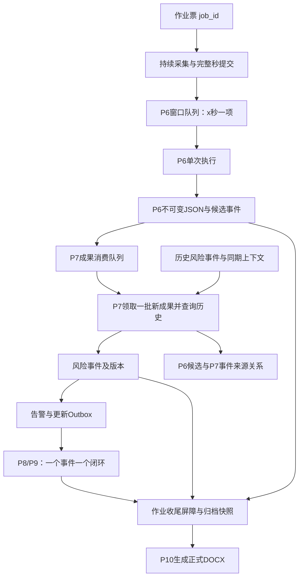

# 持续作业监测与 P6–P10 队列协同设计

> 2026-10-12。本文是目标流程与实施设计，不表示所有队列、批处理接口、主 Agent 心跳及 P10 报告已经实现。本次仅新增此文档，不修改平台、Skill、数据库或服务。代码以编写时读取的工作区版本为准。

## 1. 目标与职责

一张作业票对应一个长期业务作业 `job_id`。摄像头、传感器与定位数据持续入库；P6 每次分析一个 x 秒完整窗口，输出候选异常与正常/恢复观测；P7 每次领取多个尚未研判的 P6 成果，结合已有风险事件，完成跨窗口聚合、关联和风险研判；每个需告警的业务风险事件对应一个 P8/P9 处置闭环；作业收尾完成后，P10 汇总全过程证据和处置记录，生成一份正式 DOCX 报告。

长期作业可以包含很多次有限的 Agent 执行。主 Agent 可以由周期入口触发，子 Agent 均按任务单次执行。采集服务持续运行，不依赖模型保持在线。队列负责可靠交接，模型负责分析，业务服务负责状态校验和落盘。

| 角色 | 输入与职责 | 输出 |
|---|---|---|
| mock_player/采集服务 | 持续提交原始帧、秒级传感器、定位与 PPE 秒统计 | 不可变观测、完整区间、P6 窗口任务 |
| P6 | 分析一个完整 x 秒窗口，核对规则与证据 | 候选事件列表、正常/恢复观测、缺口说明、JSON 成果 |
| P7 | 批量消费新 P6 成果，同时查询历史，不机械套规则 | 风险事件及版本、来源关系、告警/更新意图、JSON 研判记录 |
| P8 | 针对一个事件建立和推进处置 | 一个闭环工单、通知回执、整改记录 |
| P9 | 对该闭环材料进行审核，提出意见并按既有权限规则推进 | 审核记录、通过/退回或待确认状态；不能把模型意见冒充人工确认 |
| P10 | 在固定归档快照上汇总一张票的全过程 | 一份正式 DOCX、来源清单、报告元数据与生成记录 |
| 主 Agent | 查询作业状态、积压、失败和在途任务，安排有限子任务 | 本轮调度记录、需要人工处理的异常 |

P6 的“风险描述”定义为候选异常描述，不承担最终风险等级。最终风险研判归 P7，避免两套等级计算互相覆盖。

## 2. 已实现内容与目标差距

| 编写时代码事实 | 与目标的关系 |
|---|---|
| `P_skill/Docker/mock_player/src/mock_player/schema.sql` 已有人员、设备、区域、原始 CV、传感器、定位、PPE 秒统计等关系表 | 原始数据存储已存在；不同来源采样频率不同，不能全部称为“一秒一行” |
| `processing_tasks` 与 `agent_consumers` 保存窗口消费状态、窗口范围、截止序号、租约与重试信息 | 消费状态属于“某消费者的窗口任务”，不是原始行上的唯一状态 |
| `Tasks.claim/complete` 使用写事务，完成时原子提交成果和窗口完成状态 | 可复用该可靠消费模式 |
| `agent_results.status` 是 P6 成果自身的生成状态 | 它不等于“是否已被 P7 消费”，需要独立的下游队列/消费关系 |
| 当前 `P_skill/records.py` 有不可变 JSON、风险事件版本和 `consumed` 记录 | 已有归档和消费去重基础，但没有完整的 P7 批量领取、租约、失败队列 |
| 当前 P6 Skill 直接提交 P7，当前 P7 输入使用单个 `source_ref` | 支持单成果衔接；本文的多成果批处理需要演进接口与 Skill |
| 平台已有调用授权、任务依赖、等待恢复、成果声明登记及显式传递 | 保留此调用逻辑；成果引用不等于文件内容 |
| 当前平台 Scheduler 调度已提交任务 | 不会自动周期创建主 Agent 任务；心跳入口需另行实现 |
| `a_mac_skill/P8P9` 已有作业/事件状态机和 Agent 视图 | 应复用并映射既有状态，不在新表里另建冲突状态机 |

mock_player 当前使用 `pending / processing / completed / retryable / failed`。口语中的“未处理”和“待处理”含义重复，本文明确：`pending` 为首次待处理，`retryable` 为可重试待处理，不省略 `completed` 与 `failed`。

## 3. 全链路与关系基数

应分别表达以下关系，而不是把所有记录混成一个队列：

1. 一个原始观测可以被不同用途的消费者引用。一个 P6 窗口引用多条原始观测；消费状态按消费者保存。
2. 一个 P6 执行成果包含 `0..k` 个候选事件。窗口无异常也必须有成果，作为覆盖、正常和恢复依据。
3. P6 候选事件与 P7 风险事件是 `n:m`。同一来源可支持多个事件，多条来源可共同支持一个持续事件。
4. 一个风险事件具有 `1:n` 研判版本和 `1:n` 执行/审核记录，但对应一个 P8/P9 闭环工单。模型调用次数不与事件数量保持 1:1。
5. 一张作业票下的多个窗口、事件、工单和审核记录汇总为一份正式报告，即业务上的 `n:1`。报告修订另有版本，不能覆盖之前交付版本。

## 4. 三种状态必须独立

| 状态层 | 含义 | 建议表达 |
|---|---|---|
| 作业业务状态 | 作业是否允许开始、是否正在进行、是否允许归档 | 沿用业务状态机，并保留审核结果、开工时间、结束时间等字段 |
| 平台执行状态 | 一次模型任务是否在运行 | `queued/running/waiting/succeeded/failed/cancelled/interrupted` |
| 队列消费状态 | 某批业务输入是否已经被某下游处理 | `pending/processing/completed/retryable/failed` |
| 风险观测状态 | 风险事实是否持续或恢复 | `ongoing/recovered/uncertain` 等，映射当前字段 |
| 处置状态 | 风险整改是否完成且审核通过 | 沿用 P8/P9 事件状态机 |

P6 平台任务成功不等于作业结束；P7 消费完成不等于风险解除；风险恢复不等于整改闭环。平台 `succeeded` 还需检查业务回执 `status`，不能仅据执行终态推进业务。

## 5. P6：原始数据按窗口消费

### 5.1 窗口与时间

- 窗口使用半开区间 `[start,end)`，相邻窗口边界不重复。x 为消费者配置，不由模型临时截断。
- 将观测时间 `observed_at` 与入库时间 `received_at` 分开。任务冻结 `cutoff_sequence`，后续重试读取同一输入快照。
- 只调度已完整提交的窗口。采集结束后，不足 x 秒的尾窗也要提交，不能静默丢掉。
- 真实系统迟到数据应进入补充/更正任务，不能悄悄修改已消费快照。缺口在成果中显式记录。

### 5.2 一次 P6 执行

领取窗口租约 → 查询固定窗口 → 分析候选事件与覆盖情况 → 提交成果 → 确认业务归档 → 登记平台成果声明 → 提示/提交 P7 批次执行。

成果字段至少包括 `job_id / result_id / consumer_id / window_task_id / platform_task_id / time_range / cutoff_sequence / schema_version / policy_version / summary / events[] / observations[] / completeness / limitations / evidence_refs[]`。

`observations[]` 的正常事实可以是原始记录引用或带覆盖范围的摘要，无需复制所有帧，但必须能支持 P7 核实恢复。候选事件使用稳定 `candidate_id`，不能仅靠数组下标解释跨版本关系。

### 5.3 下游入队

P6 成果提交后，为 P7 创建一项消费记录。推荐队列项对应“P6 窗口成果”，而不是每条异常单独入队。这样 `events=[]` 的窗口也能推进覆盖与恢复判断。

业务数据库内，P6 成果提交与下游入队/Outbox 写入应同事务完成。当前适配器的业务完成与 JSON 归档分步执行，需保留归档恢复路径；未确认归档成功时不能发送可读成果声明。

## 6. P7：批量领取、历史查询与 n:m 聚合

### 6.1 队列项与领取批次

建议区分：`p7_inbox` 是每个 P6 成果的消费项；`p7_batches` 是一次领取形成的固定批次；批次成员关系表保存准确输入集合。

`p7_inbox` 至少有 `job_id / source_result_id / state / batch_id / available_at / attempt_count / lease_owner / lease_token或epoch / lease_expires_at / processed_assessment_ref / last_error`；唯一约束为 `(job_id, consumer_id, source_result_id)`。状态应归队列，不改变不可变 P6 JSON。

领取时用短事务选中同一作业中按业务窗口排序的可用输入，并将它们归入固定 `batch_id`。批次限定数量、时间跨度、输入体积与最大等待时长，任一触发条件满足即可执行。不强求始终攒够 N 条，末批和紧急事件应允许提前处理。

若最早窗口尚未完成，默认不能用后续窗口确认连续恢复或作业收尾。可优先研判已知紧急事实，但将缺口记录为不确定性，不推进连续完成水位；这类优先路径需要明确的业务配置。

### 6.2 新输入与历史输入

P7 一次输入由两部分构成：

- 本批新输入：领取到的 `pending/retryable` 成果，处理后完成消费。
- 历史上下文：已经消费的 P6 成果、既有事件版本、同期证据和规则，按需只读，不能为了引用历史而重新消费。

“批量消费”不是只看未处理记录。跨批次持续事件依靠持久化事件与来源关系，不靠模型聊天历史。

### 6.3 聚合策略与来源关系

两种策略应配置并版本化，由规则限制边界、模型解释决策：

| 策略 | 处理方式 | 约束 |
|---|---|---|
| 按风险类型/对象聚合 | 同对象、同类型、同 PPE 项目的连续或复发事实聚为同一事件；不同类型保持独立并关联 | 不只凭时间接近合并；已有恢复、区域变化、作业变化应重新判断 |
| 按连续风险态势聚合 | 同一作业/区域的一段连续异常形成一个父风险事件，内部保存多个子风险项 | 保留头盔、火焰等独立子项；各子项独立更新，父事件仅在相关异常都有充分恢复证据后结束 |

示例：三个 P6 窗口均出现未戴头盔，后两个窗口还出现火焰报警。按类型可形成 E1（头盔）和 E2（火焰），同一窗口参与两者；按态势可形成 E3，其内含两个独立子风险项。两者都保留完整来源，不用一句合并摘要替代事实。

建议来源关系表：`risk_event_sources(event_id,event_version,source_result_id,candidate_id,relation_type)`。`relation_type` 可为支持、背景、恢复、反证等。新建风险应有候选支持，正常窗口可支持恢复；无风险成果可以零映射，但仍完成消费并保留原因。

聚合不能丢失不同风险的等级、处理建议和证据。关系图中的因果关联要区分已证实与推测。事件跨度是 `last_seen-first_seen`；实际异常时长按有证据的区间并集计算，中间恢复或缺数据不得计为持续违规。

### 6.4 一次 P7 提交

读固定批次 → 查询历史 → 输出聚合/关联与研判 → 保存本次研判 JSON → 在事务中写事件版本、来源边、消费完成状态和告警 Outbox → 返回成果声明。

批次输入非空但事件列表为空时仍保存执行记录；需逐个来源说明“正常/排除/仅作恢复依据/不确定”。解析失败、缺数据或模型超时不能生成默认低风险并完成队列。

`assessment_id` 标识一次执行；`risk_event_id` 标识长期风险；`event_version` 标识一次更新。更新使用预期版本校验，冲突后重读历史重评。默认同一作业一个 P7 写入者，版本校验仍用于防旧执行覆盖。

## 7. P7 → P8/P9：一个风险事件一个闭环

这里的 1:1 是 `risk_event_id : closure_case_id`，不是“每次 P7 输出或版本都重新通知一次”。持续事件每次更新保持同一个 ID，只更新既有工单。

| P7 结果 | 下游行为 |
|---|---|
| 新建且满足告警条件 | 写 `open_case` 意图，P8 建立唯一闭环 |
| 新证据/等级升级/建议改变 | 对同一工单写版本化更新；重要变化可重新通知，仍保留同一工单 |
| 已知风险事实恢复 | 更新观测状态，提供核验依据；不能自动把整改工单关闭 |
| risk_level=0、候选被排除或数据不足 | 保存研判记录，按策略复核；不伪造实际告警 |

若业务要求每个 P7 输出都进入处置，则 P7 应把“待复核记录”和“正式风险事件”分开：只有正式事件实行一事件一闭环。避免把正常窗口也开成告警。

P8 使用 `(job_id,risk_event_id)` 唯一约束建单。外部消息按 `(case_id,event_version,action,recipient)` 形成稳定幂等键；消息发送回执与业务开单是两种状态。Outbox 表示待发送意图，不能把它直接标记成“已通知”。

P8/P9 是持久化处置状态机：建单、接收、整改、提交材料、审核、退回再整改、关闭。涉及人员的等待写入业务状态并结束本次 Agent 执行，人员回复或主 Agent 后续心跳再安排下一次有限执行。不要让一个平台 `wait_tasks` 任务跨数小时等待现场人员。

相同工单的状态变更串行/版本化。P9 审核固定材料修订号，旧版本审核意见不能关闭后来修改的材料。人工决定、模型建议、工具实际动作及发送回执分别留存。

### 7.1 已开单后改变聚合关系

默认已告警的事件 ID 稳定，不破坏已发生的处置关系。后续发现两个事件相关，优先增加关联或态势父事件，不静默合并并删除原 ID。

确需拆分/合并时，记录 `supersedes/split_from/merged_into`，保留旧事件、原工单及历史。新 ID 对应新闭环；旧闭环明确转为已替代/待移交，不能直接删掉，也不能把两个既有工单强行改为一个而失去 1:1 历史。

## 8. 数据库、文件与消息的分工

| 介质 | 负责什么 | 不应承担什么 |
|---|---|---|
| 业务关系数据库 | 作业、消费队列、事件版本、来源边、闭环、报告索引与 Outbox 的权威状态 | 不把模型聊天历史当现场事实 |
| 不可变 JSON 文件 | 每次 P6/P7/P8/P9 执行的输入引用、输出、判断依据、实际回执及版本快照 | 不靠改 JSON 字段实现多进程抢占锁 |
| 平台任务与成果表 | 执行者、调用关系、执行状态、工具审计、成果声明和显式交接 | 不重复定义作业票状态机 |
| 调用消息/唤醒 | 通知某 Agent 有工作，传递 `job_id/batch_id/artifact_ids` 等引用 | 不是唯一数据副本，不以消息送达等同于消费完成 |
| DOCX | 面向业务人员的正式汇总交付物 | 不代替可查询的证据和状态数据库 |

文件按配置的持久化根目录隔离作业，建议逻辑结构：`jobs/<job_id>/P6/<result_id>.json`、`P7/<assessment_id>.json`、`events/<event_id>/v<version>.json`、`P8P9/<case_id>/<execution_id>.json`、`P10/<report_id>.docx` 与来源清单。实际物理目录可以沿用当前 scope 哈希目录，通过索引解析，不强制迁移现有文件。

保存工具返回 `provider / record_ref / relative_path / sha256 / version / content_type`；Agent 根据回执调用 `register_artifact`。调用下游时通过 `artifact_ids` 显式交接，完整内容由对应业务工具读取。下游不能凭猜出的绝对路径越过存储范围。

历史查询按 `job_id + 阶段 + 业务时间区间 + 来源/事件ID` 索引。平台当前的调用链成果访问不等于跨调用链历史检索；P7 应通过获授权业务查询工具取得必要历史，不需要读取全部平台任务表。

### 8.1 文件与数据库一致性

文件系统和数据库无法靠普通 SQL 获得跨资源原子事务。建议：生成稳定 ID → 将规范化 JSON 写临时文件并 flush/fsync → 原子 rename 发布 → 数据库事务写内容哈希、索引及业务变化 → 回执成功。只允许已提交索引的文件进入下游。

崩溃后可能出现孤立文件：重试校验同 ID/哈希后补索引；冲突内容拒绝。若多个数据库参与，用本地 Outbox 与接收端幂等处理，不声称跨库原子提交。先登记平台引用失败时可以按同声明补登记，不能重做已完成业务分析。已写数据库却归档失败的当前路径，应先补归档再交接。

## 9. Agent 交互：保留直接调用，队列负责输入集合

### 9.1 只有主 Agent 周期触发

主 Agent 每轮查询活跃作业、可用窗口、P7 队列、处置待办和在途任务；安排有限数量子任务后结束。定时器必须以任务锁和稳定调度键防重复，不启动一个无限轮询的主模型循环。

主 Agent 不必逐项介入 P6/P7 固定步骤。P6 成果入队后可直接提交一次 P7；P7 工具负责领取批次。为避免“每个窗口各提交一个 P7”造成重复启动，业务服务按作业维护 P7 在途执行预约或 dispatch Outbox：只有获得预约的调用者提交 P7；已存在执行时仅入队。本轮 P7 最多处理一个有界批次，未消费数据留给下一轮。

`request_id` 只能去重同一请求；当前平台还限制在父任务范围内。不同 P6 父任务不能仅靠相同 request_id 去重。跨父任务防重复必须由业务调度记录/作业锁承担。

P6 不必等待所有积压 P7 成果处理完。可等待本次实际提交的有限 P7 执行，也可在确认入队和任务提交后结束，最终输出分别记录 P6 已完成、P7 已提交/执行中/完成。达到批次条件但直接提交失败时，主 Agent 后续根据持久化队列补提交，不依赖模型记住上次失败。

P7 提交 P8/P9 同理：先持久化工单意图，再提交一次执行。消息丢失不丢业务，任务重复不重复开单。P8/P9 的人工等待留在业务状态，不长期占据 P6 或主 Agent 的父任务。

### 9.2 建议工具契约（待实现/调整）

| 工具逻辑操作 | 身份与输入 | 服务端保证 |
|---|---|---|
| `claim-p6-window` | 固定消费者/当前执行身份 | 完整快照、独占租约 |
| `complete-p6` | 租约与分析结果 | P6 成果、归档索引与 P7 入队协调提交 |
| `claim-p7-batch` | 作业 scope、固定批次上限 | 单作业批次预约、成员快照、租约 |
| `read-p7-batch` | batch_id | 只能读取本租约输入及允许历史 |
| `query-risk-history` | job_id、时间、对象、事件ID | 限域、有界分页及真实历史版本 |
| `complete-p7-batch` | batch_id、租约、预期事件版本、研判 | 事件、n:m 来源、消费完成及 Outbox 原子更新 |
| `fail/renew-batch` | 当前租约 | 过期凭证拒绝、延迟重试 |
| `claim-disposition` / `commit-disposition` | case_id、状态版本 | 一事件一工单、状态迁移校验 |
| `prepare-report-snapshot` | job_id | 检查收尾屏障并固定清单 |
| `save-report` | snapshot_id、生成文件 | DOCX 留存、哈希、唯一正式版本 |

平台 `submit_task / wait_tasks / register_artifact / get_artifact` 保持通用，不把 P6/P7 业务队列语义塞入通用调度器。

## 10. 并发边界

| 操作 | 建议并发 | 原因与约束 |
|---|---|---|
| 采集与 P6 分析 | 可以 | P6 读取冻结快照，不阻塞采集 |
| 不同作业的 P6/P7 | 可以 | 按 job_id 隔离任务、历史与文件 |
| 同作业不同 P6 窗口 | 初期串行；吞吐不足后可有限并行 | 分析可独立，但完成可乱序；需要连续完成水位和下游排序 |
| P6 与同作业 P7 | 可以 | P7 只读已提交成果；P6 可继续产生新成果 |
| 同作业多个 P7 写入批次 | 默认不可以 | 跨事件/态势聚合存在重叠；单写入者避免重复新建和丢失更新 |
| P7 历史/证据查询 | 可以并行读取 | 使用固定输入快照，读取不写状态 |
| 按人员/风险类型拆 P7 分区 | 后续优化，非初期默认 | n:m 与跨类型态势会跨分区，必须有额外协调，不能仅凭对象不同判独立 |
| P7 与 P8/P9 | 可以 | P8/P9 按事件版本处理，P7 更新不直接覆盖处置状态 |
| 不同事件的 P8/P9 | 可以 | 独立工单；作业级暂停/恢复等共享动作需集中协调 |
| 同工单的处置/审核状态提交 | 不可以无约束并行 | CAS 版本校验、材料修订号与合法迁移 |
| 多事件触发同一次作业级动作 | 协调后单次执行 | 全局幂等键和状态机防重复暂停、冲突恢复 |
| P10 与已关闭快照的读取 | 可以读取 | 正式报告基于固定 snapshot，不读不断变化的 latest |
| 同作业同快照生成正式报告 | 一个有效提交者 | 并行生成可能浪费，正式产物唯一且可重试 |

SQLite 写事务应短，不把模型调用或文件上传放在长事务内。数据库选择只影响并发上限，不改变业务隔离规则。

## 11. 租约、重试、积压与顺序

统一消费迁移：`pending → processing → completed`；执行失败进入 `retryable`，到达重试时间再领取；超出次数进入 `failed` 等待人工处理。租约续租工具的 heartbeat 是凭证保活，不是 Agent 周期执行心跳。

领取、批次成员绑定使用短事务；提交核对租约 token/epoch 与事件版本。过期执行不能提交。完成请求回执未知时先查询 batch/result，再决定是否同输入重试。采用至少一次调度＋幂等业务效果，不承诺外部通知严格 exactly-once；供应商不支持幂等时，用真实回执核对未知结果。

批次失败默认整体不提交，避免部分输入已消费但事件来源不完整；若设计部分成功，必须有明确子提交单元与独立幂等键，不能在异常后随意标记全部完成。

同作业允许已知风险先研判，但不能跳过失败早窗后宣布整段覆盖完整。毒任务转失败队列、保留缺口和责任人；失败任务未处理时正式报告记录或阻止归档，不通过删任务伪造无风险。

若 x=5 秒，每个作业每分钟产生约 12 个 P6 窗口。单 worker 平均每窗口耗时 L6，处理能力约 `60/L6` 个/分钟；当 L6>x 会积压。P7 每批 b 个窗口，平均耗时 L7，能力约 `60*b/L7`。主心跳每 h 秒只安排一个 P6 时，能力还受 `60/h` 限制。应根据实际测量调整 x、批量、并发和调度数量。

监控至少包括队列深度、最早待处理窗口年龄、连续覆盖水位、租约过期、失败次数、采集→研判→通知延迟。紧急事件的最大等待不能由大批量策略无限拉长；平台时序调度不代替现场已有实时告警与控制设施。

## 12. 作业收尾与 P10 的 n:1 报告

“停止作业”“风险恢复”“闭环完成”“归档完成”应分别记录。收尾过程：

1. 记录业务作业结束时间，采集服务提交至确定截止点；按政策停止或保留后续安全观察，分别标识覆盖范围。
2. 生成尾窗，排空截止点之前全部 P6 窗口；核对数据缺口和连续完成水位。
3. 排空相应 P7 消费队列及在途批次，完成已知风险的最终研判。未知不能伪造成恢复。
4. 确认所有需要处置的事件都有闭环；按业务权限完成 P8/P9 审核和关闭。未完成事件只能生成明确标注的阶段报告，不能声称正式结案。
5. 生成不可变 `report_snapshot_id`：记录 job 状态版本、截止时间、P6 result_id 清单、P7 assessment_id 与事件版本清单、闭环与审核版本、通知回执、规则版本、缺口和豁免。
6. P10 单次读取快照，形成作业概况、时序、风险演变、证据、处置与审核、统计、限制与复盘建议，生成正式 DOCX，并保存生成 JSON 和来源清单。
7. 工具确认 DOCX 可读、内容与引用完整、哈希与保存位置后登记成果。正式版本唯一约束 `(job_id,snapshot_id,report_type)`；后续更正用新快照和新报告版本。

P10 统计时按 risk_event_id 去重，不能把十次事件版本统计成十次风险；异常时长按证据区间统计，处置时间按工单记录计算。DOCX 是一张票的总结，执行 JSON 和全部证据继续独立留存。

## 13. 最小验收场景

| 场景 | 应观察到的结果 |
|---|---|
| 连续三个窗口同人同类异常 | 一个持续风险、多条来源、一个闭环，版本更新不重复开单 |
| 同时头盔缺失和火焰报警 | 按类型生成两个事件，或按态势生成含两个子项的一个事件；策略可追溯 |
| 正常窗口/空候选 | P6/P7 执行照常留存，只有充分正常证据才支持恢复 |
| 批次包含早窗重试及后窗完成 | 不丢来源、不错误扩大持续时长、不误推进完整水位 |
| 两个 P6 同时提示 P7 | 数据全部入队，同作业只产生一个有效批次执行预约 |
| 完成请求超时、旧 worker 后到 | 同结果可核对恢复，旧租约写入拒绝，无重复事件/工单 |
| P7 成果提交后平台登记失败 | 补登记成功，不重新消费和重建事件 |
| 两个事件同时要求暂停作业 | 共享作业动作只执行一次，两个事件都关联真实回执 |
| 整改材料更新与 P9 并发审核 | 旧意见不能关闭新材料版本 |
| 作业结束有不足 x 秒尾窗 | 尾窗完成、P7 消费完整后才允许正式归档 |
| P10 读取期间迟到证据到达 | 当前报告固定原快照，后续更正生成新版本 |
| 服务重启与平台重启 | 业务记录可恢复；平台 interrupted 明确可见，经核对再安排新执行 |

## 14. 实施顺序

1. 保留 mock_player 原始表及 P6 窗口租约机制；明确 job_id/scope 映射和证据覆盖字段。
2. 新增 P7 inbox/batch、来源关系及版本化风险事件，先实现批量领取与提交的服务契约和故障测试。
3. 将 P6/P7 单成果直接调用演进为“P6 入队并提示、P7 工具领取固定批次”，保持当前平台授权与任务调用机制。
4. 对接既有 P8/P9 状态机；建立唯一工单与告警 Outbox、版本化更新、人工等待恢复。
5. 增加主 Agent 的周期触发与跨轮在途防重；平台任务 ID 不代替业务 job_id。
6. 增加收尾屏障、报告快照与 P10 DOCX 生成/留存能力，最后验证全过程及恢复路径。

## 15. 代码依据

- [mock_player 关系表与窗口消费状态](../../P_skill/Docker/mock_player/src/mock_player/schema.sql)
- [窗口领取、租约、完成与重试](../../P_skill/Docker/mock_player/src/mock_player/tasks.py)
- [P6 成果与原始证据关系](../../P_skill/Docker/mock_player/src/mock_player/results.py)
- [当前 P6 Skill](../../P_skill/P6/p6-monitor/SKILL.md)
- [当前 P7 Skill](../../P_skill/P7/p7-risk/SKILL.md)
- [现有 JSON 归档、事件版本与单来源消费](../../P_skill/records.py)
- [平台成果声明与访问](../platform_core/artifacts.py)
- [平台调用关系与授权](../platform_core/tasks.py)
- [现有执行调度器](../platform_core/scheduler.py)
- [P8/P9 状态机](../../a_mac_skill/P8P9/state_machine.py)
- [P8/P9 Agent 视图](../../a_mac_skill/P8P9/agent_interface.py)
- [P10 既有阶段说明](../../docs/agents/P10_ARCHIVE_AGENT.md)

上述相对链接以本文所在目录解析。本文中建议的新队列名、批次工具名和状态字段是实施契约草案，不是对现有 API 已实现功能的声明。

## v5 当前机制

P6 的 read_current_window 返回作业范围内完整 monitoring_data（PPE秒统计、传感器、位置及元数据）和全部观测通道；未配置风险规则的通道也返回，规则仅作参考。read_current_evidence 支持 source=cv 分页读取同窗原始逐帧证据。位置离开授权区域也保留供研判。descriptions 必须覆盖全部观察序号，每项包含 observation/state/explanation，可用 exceptions 的 from_sample/to_sample（从1起闭区间）表达变化。逐秒数据不预先合并，P6按窗聚合，P7按事件聚合；未知证据不能声明正常。

人工关闭入口：POST /api/connections/{connection_id}/confirm-job-closed，参数 job_id（建议显式指定）、actor、reason、mode=human_override。入口只供可信管理操作，未向模型注册。核验已登记且有审核权的人工身份后，无论闭环检查有多少阻塞，立即关闭作业；未解决风险保留，阻塞记录在 unresolved_at_close。关闭、失效领取及释放当前票在同一业务事务；平台停止该票计划、取消在途任务，迟到写入被拒绝。mode=normal保留常规闭环检查。关闭后新票必须重新绑定，新心跳不能沿用旧票计划。

平台 submit_task 与 set_heartbeat_schedule 可传 timeout_seconds，不超过Agent上限。超时任务进入 failed/TASK_TIMEOUT，先持久化运行撤销标记，再由平台回收领取；P6领取前已登记失败回收意图，返回丢失也能恢复。已提交业务结果不回退，旧执行不能在重试后写入。租约到期仍作为平台不可用时的兜底。

心跳每轮创建独立根任务和独立对话。overlap_scope=self默认只检查目标Agent本身（包括手工任务），上一轮未结束则skip，不补排；子Agent在途不会阻塞下一轮Main。chain选项才检查整条协作链。每个计划固定创建时作业范围，关闭后停止。Main每轮查询业务状态与同票此前自己提交的任务，有限补位后立即结束，不等待全部子任务或全作业闭环。单次验收任务仍可wait_tasks。

平台注册的真实飞书连接为P8P9；旧P-skill-MOCK已移除。模型提示词不得宣称真实发送为模拟。F演练阈值在P6 Skill说明中，不作为生产规范。
